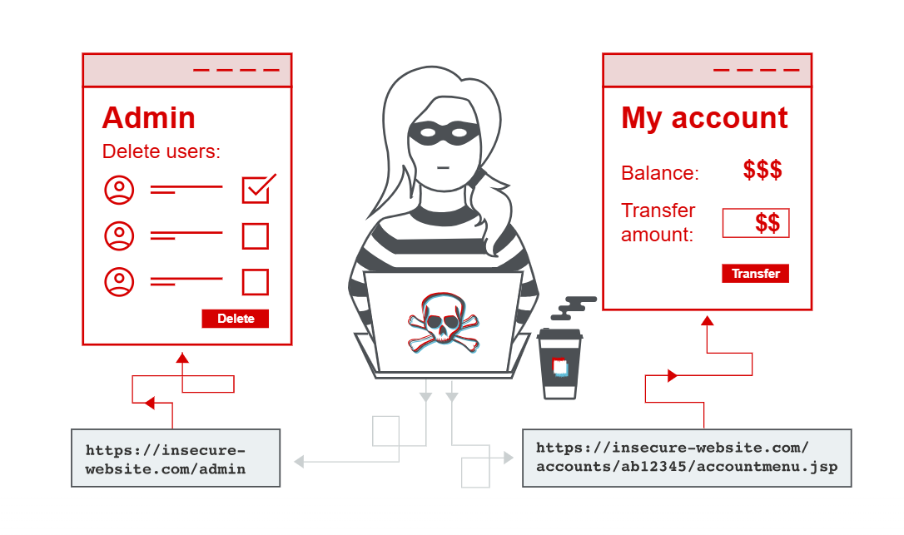

# Access Control

## 1. What Is Access Control?

Access control is a security mechanism that defines **who or what is authorized to access resources or perform specific actions** within an application.

In web applications, access control works alongside authentication and session management.

## 2. Three Core Components

| Component | Purpose |
|---|---|
| **Authentication** | Verifies the identity of a user. |
| **Session Management** | Maintains and identifies the user's authenticated session across subsequent HTTP requests. |
| **Access Control** | Determines whether the authenticated user is permitted to perform a particular action or access a resource. |

### Example

Consider an e-commerce application:

- **Authentication:** Verifies that the user has logged in successfully.
- **Session Management:** Identifies subsequent requests as belonging to that logged-in user.
- **Access Control:** Determines whether the user can view an order, modify account details, or access administrative functionality.

## 3. Broken Access Control

Broken access control occurs when an application fails to properly enforce authorization restrictions, allowing users to access resources or perform actions beyond their permitted privileges.

It is a common web application security vulnerability and can have critical security implications.

### Why Does It Occur?

- Incorrect access control implementation.
- Missing authorization checks.
- Improper role and permission management.
- Failure to enforce business and organizational security requirements.
- Human errors during access control design and implementation.

## 4. Security Impact

Depending on the weakness, broken access control may allow an attacker to:

- Access another user's sensitive information.
- Modify or delete unauthorized resources.
- Perform administrative actions without permission.
- Escalate privileges.
- Access restricted application functionality.

    

**Key Takeaway:** Authentication establishes who the user is, session management maintains their identity across requests, and access control determines what they are allowed to do.
