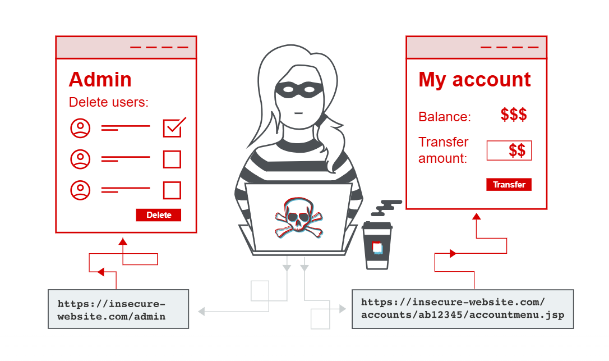

## Lab: Exploiting Unprotected Admin Functionality

### Steps

1. Open the lab and append `/robots.txt` to the lab URL.

     

2. Check the `Disallow` entry to identify the disclosed admin panel path.

     

3. Replace `/robots.txt` in the URL with `/administrator-panel` to access the admin panel.

  

4. Locate the user **carlos** and delete the account.

     

### Expected Result

The `robots.txt` file reveals the hidden administrative endpoint, which can be accessed without proper authorization.

**Conclusion:** The application has unprotected administrative functionality, resulting in vertical privilege escalation.

**Pictorial Representation:**
